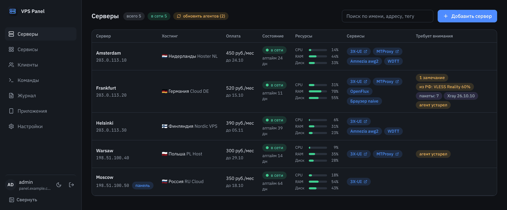
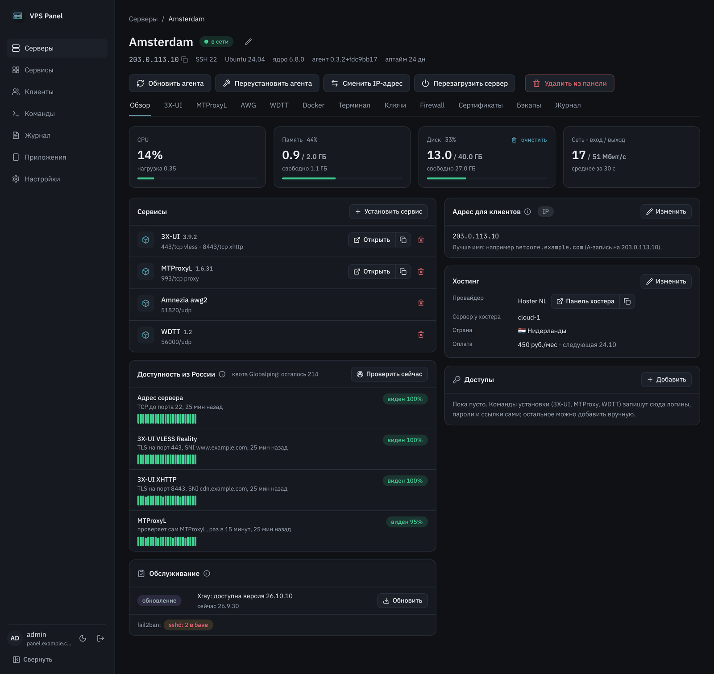
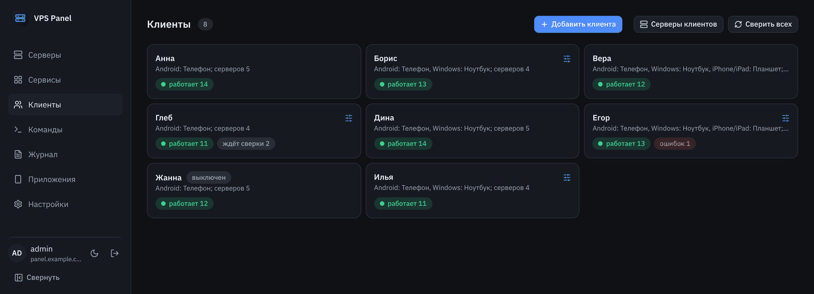
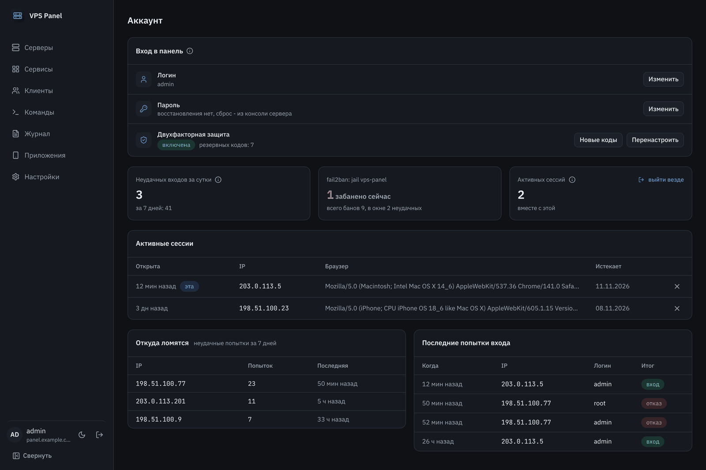
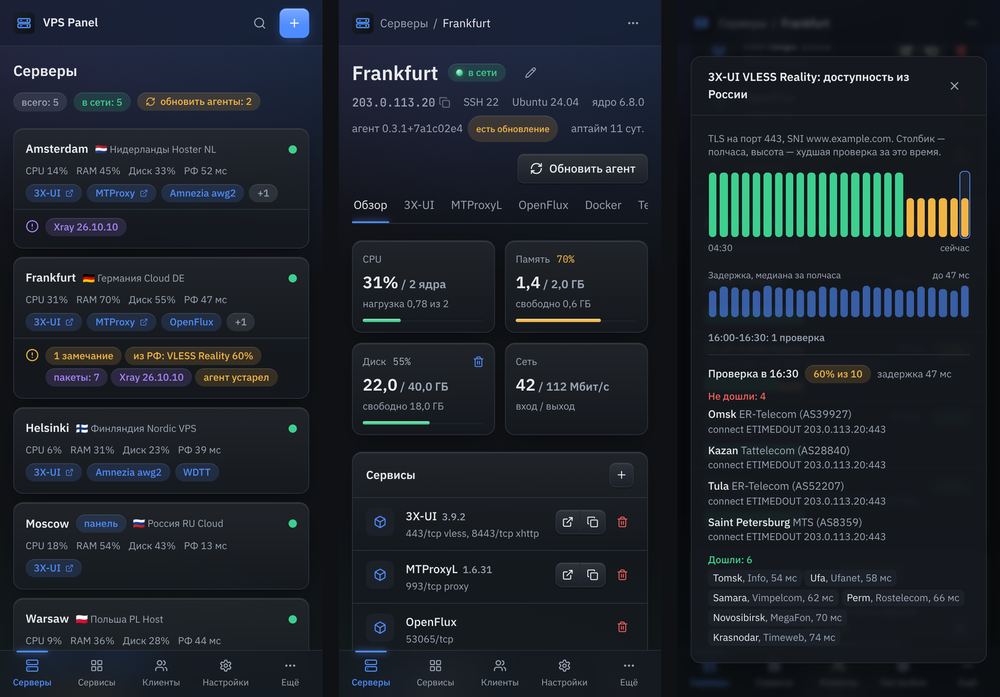

# VPS Panel

Своя веб-панель для небольшого парка VPS с VPN-сервисами: серверы, сервисы и клиенты в одном
месте, подписки и личные страницы клиентов, аудит безопасности, уведомления в Telegram.

[](https://github.com/iKonan-ru/vps-panel/releases)
[](https://github.com/iKonan-ru/vps-panel/actions/workflows/ci.yml)
[](LICENSE)

> [!WARNING]
> **Дисклеймер.** VPS Panel - личный проект для управления собственными серверами и
> предназначен только для личного использования. Он не рассчитан на производственную
> (коммерческую, промышленную) среду: там его используют на свой риск, без поддержки и
> гарантий. Запрещено использовать проект в незаконных целях и способами, нарушающими законы
> вашей страны, страны размещения серверов или правила хостинг-провайдера. Вы сами отвечаете
> за то, как применяете панель и установленные ею сервисы. Программа распространяется "как
> есть", без каких-либо гарантий; автор не несёт ответственности за любой ущерб от её
> использования (подробно - разделы 15 и 16 [лицензии](LICENSE)).



## Установка

Нужен сервер с Linux (проверено на Ubuntu 24.04), root и свободные порты 80 и 443. Домен - по
желанию: с ним панель живёт на `panel.example.com` (плюс `sub.example.com` для подписок и
`*.example.com` для панелей сервисов), без него - на `https://<IP сервера>` с сертификатом
Let's Encrypt на IP.

```bash
bash <(curl -fsSL https://raw.githubusercontent.com/iKonan-ru/vps-panel/main/install.sh)
```

Установщик спросит домен (Enter - без домена), имя подписок, почту для Let's Encrypt и логин
администратора (Enter - случайный), проверит DNS и порты, поставит docker, если его нет,
скачает готовые образы (amd64 и arm64), создаст администратора со случайным паролем и
запустит панель. В конце - сводка для входа; сохраните её в надёжном месте:

```
================================================================
 VPS Panel 1.14.2 установлена
================================================================
 Адрес:      https://panel.example.com
 Логин:      admin-k7m2qa
 Пароль:     Xq7mK2pRtV9bN4wLc8Hs
 2FA:        настраивается при первом входе (приложение-аутентификатор)
================================================================
```

Ключи: `--beta` - предварительный канал, `--version X.Y.Z` - конкретная версия, `-y` - без
вопросов (`PANEL_DOMAIN`, `ACME_EMAIL`, `SUB_DOMAIN`, `PANEL_LOGIN` из окружения).

После установки:

1. Войдите с логином и паролем из сводки и настройте двухфакторную аутентификацию (2FA):
   панель покажет QR-код для приложения-аутентификатора и резервные коды. Пароль меняется в
   разделе "Аккаунт"; восстановления нет - сброс только из консоли сервера
   (`vps-panel admin password`).
2. "Настройки" - "Резервная копия панели": задайте пароль и включите ежедневную отправку в
   Telegram.
3. "Серверы" - "Добавить сервер": панель поставит агента по SSH или даст команду для
   ручного запуска.

Подробнее (DNS, панель без домена, переменные, восстановление, сеть из России) - [установка и
обслуживание](docs/install.md).

## Возможности

**Серверы.** Список всех VPS с состоянием, нагрузкой, хостингом, датой оплаты и цветными тегами
(фильтр по тегу); карточка сервера с метриками, firewall (ufw и port-sync), docker,
сертификатами, резервными копиями, веб-терминалом без открытого SSH и журналом действий. Агент
на каждом VPS подключается к панели сам по шифрованному каналу и доверяет только её ключу. Новый
сервер настраивается в один клик: безопасность, все сервисы, соединения VLESS и клиенты;
резервная копия сервера разворачивается на чистый сервер вместе с установкой сервисов. Смена IP
у хостера и имя сервера для клиентов - кнопками.



**Сервисы.** 3X-UI (Xray: VLESS Reality и XHTTP), MTProxyL, AmneziaWG 2.0 и 3.x, WDTT,
OpenFlux и прокси для браузера (NaiveProxy) - установка из каталога команд с проверкой перед
запуском и живым выводом, обновления, вход в панели сервисов через панель (без открытых
портов). Сервисы, установленные вручную, панель находит сама. Соединения VLESS (RAW и XHTTP с
Reality) добавляются кнопкой во вкладке 3X-UI: цель Reality подбирается с самого сервера (из
зарубежных или российских сайтов, адресов рядом с сервером или своих адресов), порт проверяется,
после добавления панель убеждается, что Xray работает, и сразу заводит в них клиентов.

**Каскад.** Клиент подключается к одному серверу (например, российскому), а в интернет выходит
через другой: панель создаёт на входе inbound, на выходе - служебного клиента, и правила
маршрутизации Xray. Что идёт через выход: всё, всё кроме российского (по умолчанию) или только
заблокированное в России; плюс свои списки "всегда напрямую" и "всегда через выход". Панель
проверяет выход раз в 5 минут и сообщает в Telegram, если он не отвечает; ссылки через вход
попадают в подписки рядом с прямыми.

**Клиенты.** Клиент заводится один раз: панель создаёт его во всех сервисах на всех серверах
(или на выбранных) и синхронизирует серверы с панелью. У клиента - подписка для Happ, v2rayNG,
Hiddify и личная страница: конфиги AWG с QR, ссылки MTProxy, WDTT, OpenFlux, расширение для
браузера (Chrome, Firefox) и приложения под его ОС. В карточке клиента - живая статистика: на
связи ли, скорость, трафик.



**Безопасность.** Аудит каждого сервера (SSH, ufw, fail2ban, порты мимо firewall, открытые
панели сервисов, обновления, диск, упавшие сервисы) с исправлением в один клик. Вход в
панель - пароль и обязательная 2FA, пауза после неудачных попыток, fail2ban; раздел
"Аккаунт" - имя в панели, логин, пароль, 2FA, резервные коды, сессии и попытки входа.



**Наблюдение.** Доступность из России: зонды Globalping в российских домашних сетях
проверяют адрес и каждый inbound раз в полчаса и меряют задержку (в списке серверов - "из РФ
32 мс"), по нажатию на график - из каких городов и сетей сервис виден, а из каких нет, и
задержка по каждому городу. Уведомления в Telegram по событиям (сервер пропал,
сервис упал, не виден из РФ, замечания аудита, баны, обновления, оплата хостинга; имя
сервера в сообщении - ссылка на его карточку в панели, при падении сервиса - сразу на вкладку
сервиса) и ежедневная зашифрованная резервная копия панели - даже если api.telegram.org с сервера панели
недоступен.

**Обслуживание.** Панель обновляется из интерфейса - кнопкой или автоматически в заданное
время, с откатом при неудаче; агенты на серверах - вслед за ней. Интерфейс на русском,
работает с телефона (PWA), тёмная и светлая темы.



Все возможности подробно - [docs/features.md](docs/features.md).

## Управление

Версия панели - рядом с логотипом в меню; новая подсвечивается и ведёт к обновлению.
"Настройки" - "Версия панели": новые версии со списком изменений, обновление кнопкой,
"Канал обновлений" (стабильный или предварительный), "Автоматическое обновление панели" в
заданное время (местное) и "Автоматическое обновление агентов". Если новая версия не
запустилась, возвращается прежняя. Версии 3X-UI, Xray и MTProxyL с кнопками обновления - в
блоке "Версии" на вкладке сервиса в карточке сервера.

На сервере панели есть команда `vps-panel`:

| Команда | Что делает |
| --- | --- |
| `vps-panel status` | версия, канал, состояние контейнеров |
| `vps-panel update [X.Y.Z]` | обновить до версии или до последней в канале |
| `vps-panel rollback` | вернуть прошлую версию |
| `vps-panel channel stable\|beta` | канал обновлений: стабильный или предварительный |
| `vps-panel admin` | логин администратора, 2FA, открытые сессии |
| `vps-panel admin password` | новый случайный пароль администратора (восстановления в панели нет) |
| `vps-panel admin 2fa` | сбросить 2FA - настроится заново при входе |
| `vps-panel domain <имя>` | перевести панель на домен (была по IP или на другом домене); прежний адрес продолжает работать |
| `vps-panel restore <файл>` | восстановить панель из резервной копии ("Настройки" - "Резервная копия панели") |
| `vps-panel logs [panel\|caddy]` | журналы |
| `vps-panel restart` | перезапустить панель |
| `vps-panel fail2ban` | заново поставить jail fail2ban входа в панель (при обновлении - автоматически) |
| `vps-panel uninstall` | снять панель, данные остаются (`--purge` - удалить и их) |
| `vps-panel uninstall --full` | снять всё, что ставила панель на этом сервере: агент, прокси для браузера, port-sync, VPN-сервисы (с отдельным подтверждением), docker, если его ставил установщик |

## Документация

| Документ | О чём |
| --- | --- |
| [docs/install.md](docs/install.md) | установка, переменные, обновление, удаление, резервная копия и восстановление |
| [docs/features.md](docs/features.md) | все возможности и сервисы на серверах |
| [docs/architecture.md](docs/architecture.md) | как устроено и как защищено |
| [docs/development.md](docs/development.md) | разработка, проверки, релизы, структура репозитория |
| [CHANGELOG.md](CHANGELOG.md) | изменения по версиям |
| [apps/agent/README.md](apps/agent/README.md) | агент: конфиг, операции, сборка, удаление |
| [apps/extension/README.md](apps/extension/README.md) | расширение Chrome и Firefox |
| [deploy/README.md](deploy/README.md) | файлы выкладки и сборка релиза: Caddy, fail2ban, маршрут до Telegram |

## Благодарности

Панель управляет чужими проектами и опирается на них:

- [MHSanaei/3x-ui](https://github.com/MHSanaei/3x-ui) и [XTLS/Xray-core](https://github.com/XTLS/Xray-core)
- [Liafanx/MTProxyL](https://github.com/Liafanx/MTProxyL) и [telemt/telemt](https://github.com/telemt/telemt)
- [amnezia-vpn](https://github.com/amnezia-vpn): AmneziaWG и клиенты Amnezia
- [SpaceNeuroX/proxy-turn-vk-android](https://github.com/SpaceNeuroX/proxy-turn-vk-android) и [Regstar2/pwdtt](https://github.com/Regstar2/pwdtt): WDTT
- [p1neappleXpress/OpenFlux](https://github.com/p1neappleXpress/OpenFlux) и форк клиента для Android [damnurmum/OpenFlux-Android](https://github.com/damnurmum/OpenFlux-Android)
- [klzgrad/naiveproxy](https://github.com/klzgrad/naiveproxy) и [klzgrad/forwardproxy](https://github.com/klzgrad/forwardproxy)
- [caddyserver/caddy](https://github.com/caddyserver/caddy)
- клиент подписок [Happ](https://github.com/Happ-proxy)

## Лицензия

[GNU AGPL-3.0](LICENSE) (только версия 3). Copyright (C) 2026 Eugene Kononenko.

Кто распространяет изменённую панель или даёт людям работать с ней по сети (интерфейс,
подписки, личные страницы), обязан открыть им исходный код своей версии под той же
лицензией. Сторонние программы, которые панель ставит или несёт с собой (xray в образе,
сборки wdtt-server и Caddy с forwardproxy, проекты из "Благодарностей"), остаются под своими
лицензиями.
